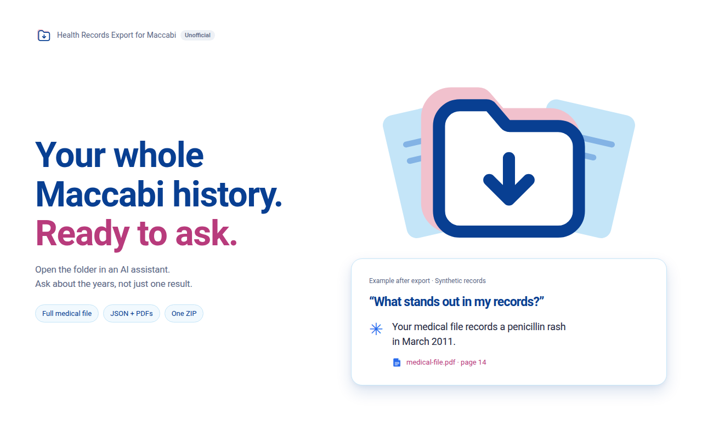
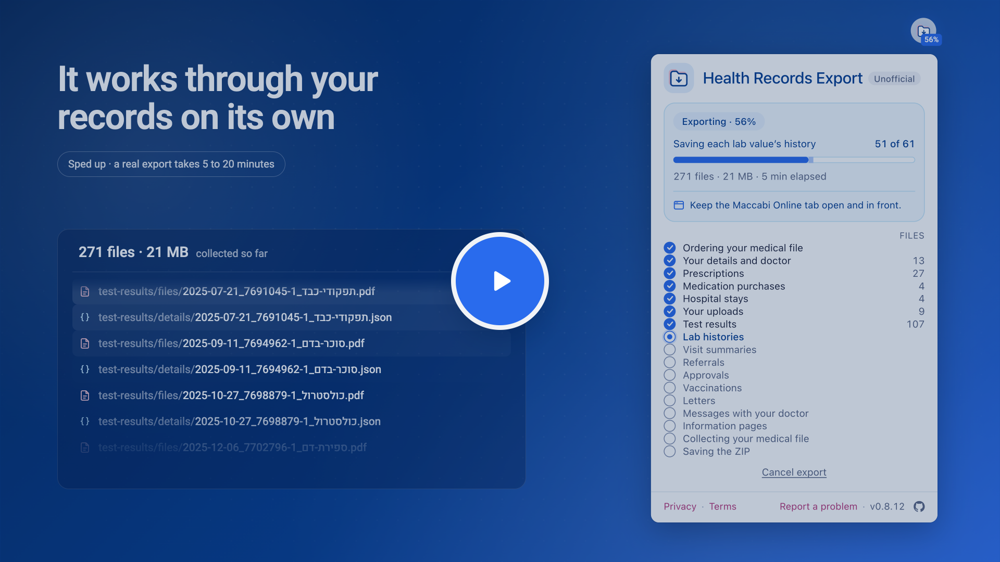
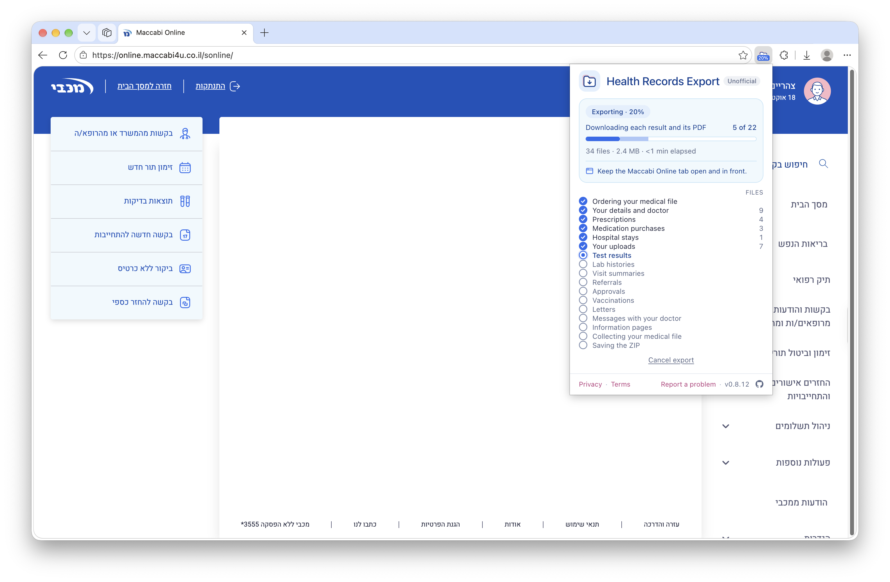
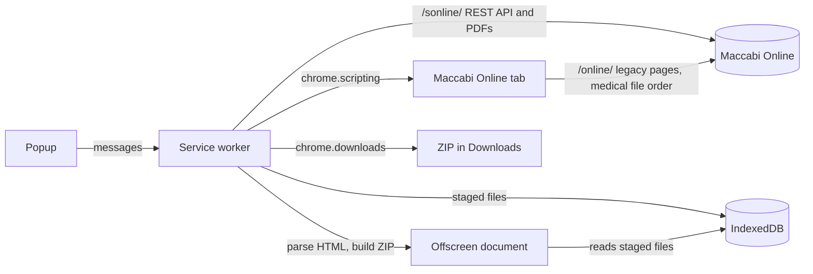

# Health Records Export for Maccabi

**Your whole Maccabi history, and a genius friend who's read all of it.**

Save everything from [Maccabi Online](https://online.maccabi4u.co.il) to your computer, then ask anything: what
changed, what stands out, what to do next. This Chrome extension saves your records and their PDFs as one
ZIP, and you open the folder in the Claude or ChatGPT desktop app. It's free, and your records stay on your computer.

Maccabi Online shows your records one page at a time, within date limits. The export puts every record in one place,
where an assistant can read all of it.

> [!NOTE]
> Unofficial. Not affiliated with, endorsed by or sponsored by Maccabi Healthcare Services.

<p align="center">
  <a href="https://chromewebstore.google.com/detail/lmjcbhajlnbpldofejcglcdclceampjp?utm_source=github&amp;utm_medium=readme">
    
  </a>
</p>

<p align="center">
  <a href="https://maccabi.ronirachmani.com/#ask">
    
  </a>
</p>

<p align="center">
  <a href="https://maccabi.ronirachmani.com/">maccabi.ronirachmani.com</a>: <a href="https://maccabi.ronirachmani.com/#ask">what to ask your AI assistant</a>, and <a href="https://maccabi.ronirachmani.com/#where">where to open your export</a> · every record in the picture is made up
</p>

- **Everything, in one place.** Your full medical file, ordered for the widest range Maccabi allows, plus every result,
  visit, prescription, referral, vaccination and letter the site has, including what its own screens cut off. Some
  things [aren't included](#not-included).
- **A friend who's read it all.** Ask what stands out, what changed in your latest blood test, or what to raise with
  your doctor on Thursday. It reads the Hebrew, answers in plain English, and names the record behind every answer, so
  you can check it. It advises; you and your doctor decide.
- **Yours to keep, and to grow.** Take it to a private doctor or one abroad, and keep it through a move or a switch of
  health fund. Add to it as you go (a private clinic's letter, a new result, notes from abroad), and it becomes a health
  record you keep, not a one-time snapshot.

<p align="center">
  <a href="https://youtu.be/0-K1rAA4uMM">
    
  </a>
</p>

<p align="center">
  ▶︎ <a href="https://youtu.be/0-K1rAA4uMM">Watch an export, start to finish</a> · 1 minute, narrated
</p>

[Install](#install) · [Export your records](#export-your-records) · [What's in the ZIP](#whats-in-the-zip) ·
[Privacy and safety](#privacy-and-safety) · [Development](#development)

## Install

You need Chrome 120 or newer.

**[Install from the Chrome Web Store](https://chromewebstore.google.com/detail/lmjcbhajlnbpldofejcglcdclceampjp?utm_source=github&utm_medium=readme)**, and
Chrome keeps it up to date. However you install it, the build isn't minified, so you can read exactly the code that
runs.

<details>
<summary>Load it unpacked, or build it from source</summary>

1. Download `health-records-export-for-maccabi-<version>.zip` from the
   [latest release](https://github.com/RoniRachmani/health-records-export-for-maccabi/releases/latest) and unzip it.
2. Open `chrome://extensions` and turn on **Developer mode**.
3. Click **Load unpacked** and select the unzipped folder, the one with `manifest.json` in it. Keep the folder: Chrome
   loads the extension from it.

Chrome doesn't update an unpacked extension. To move to a newer one, download it again over the same folder and press
the reload arrow on `chrome://extensions`. Finish or stop an export first: a reload ends it.

To build it yourself, you need Node.js 22 or newer:

```sh
git clone https://github.com/RoniRachmani/health-records-export-for-maccabi.git
cd health-records-export-for-maccabi
npm install
npm run build
```

Then load the `dist/` folder the same way.

</details>

## Export your records

1. Log in to Maccabi Online as usual.
2. On that tab, click the extension's icon and press **Start export**. The first time, read the notice and press
   **Agree and continue**. Nothing is read from the tab until you do.
3. Leave the tab open and in front. It starts on the old site's medical-file page, to order your file and collect the
   parts that live there, then returns to the new site for the rest. The toolbar badge shows progress.
4. Usually after a few minutes (up to 20 if the medical file is slow to arrive), `maccabi-export-YYYY-MM-DD.zip` is in your Downloads folder and Chrome notifies you.
5. Unzip it, open the folder in the Claude or ChatGPT desktop app and ask. See
   [Hand it to an AI assistant](#hand-it-to-an-ai-assistant).

<p align="center">
  
</p>

### Before you start

- **Maccabi Healthcare Services will text you, right at the start.** Each export orders a fresh copy of your full medical file, first
  thing, so Maccabi Healthcare Services can build it while everything else is collected. It sends the site's own order request, but asks
  for your whole history, which is wider than the range the site's form offers. Maccabi Healthcare Services sends an SMS, and the new file
  replaces the previous one on the site. A copy ordered earlier the same day over the same range is used as it is.
  This is the only change the extension makes to your account, and it happens even if the export later fails.
- **Keep the Maccabi Online tab in front.** Chrome pauses hidden tabs, which can end your session. If you switch away, the
  export waits until you come back.
- **Don't log in to Maccabi Online anywhere else while it runs.** Maccabi keeps one session per member, so logging in
  from another browser or computer ends the one the export is using.
- **Your session is kept awake.** Maccabi Online logs you out after about six minutes without a click, so while an
  export runs the extension signals activity in that tab every few minutes. It stops as soon as the export does.

### If something goes wrong

| The popup says | What to do |
|---|---|
| **Export paused** | Your session ended, and the extension couldn't reconnect by itself. Log in to Maccabi Online again, click the icon on that tab and press **Resume**. Also shown after Chrome restarts mid-export. |
| **Waiting for the Maccabi Online tab** | Bring the tab back to the front. The export continues on its own. |
| **Export stopped** | Press **Try again** on the Maccabi Online tab. It continues from the step that failed. |
| **The ZIP was not saved** | Press **Save again**. Also shown when Chrome closed while the ZIP was downloading. |

Resume refuses to continue if a different member is logged in. **Cancel export** ends the export and deletes the files
collected so far, once you confirm it.

A single item that fails doesn't stop the export. It's listed in the popup when the export finishes, and stays
there until the next export starts. The ZIP records it too, in `export-errors.json`, so whoever reads the export
later can tell a section that failed from one that had nothing in it.

## What's in the ZIP

One folder, `maccabi-export-YYYY-MM-DD/`:

| Folder | Contents |
|---|---|
| `profile/` | Member details, entitlements, insurance seniority, your doctors' provider details |
| `my-doctor/` | Assigned doctors and eligibilities |
| `test-results/` | Test list, each result, a history per lab measurement, latest lab results, result PDFs |
| `visit-summaries/` | Visits of the last 12 months, and older ones that answered an inquiry to your doctor, with their summary PDFs |
| `medications-and-prescriptions/` | Prescriptions and their PDFs, full purchase history, purchase report PDF |
| `referrals/` | Referrals and their PDFs |
| `approvals/` | Medical certificates, approvals and specialists' answers to your doctors, and their PDFs |
| `info-pages/` | Information pages from your visits, and their PDFs. Only when the site lists any |
| `vaccinations/` | Vaccinations by group, flu vaccine eligibility, vaccination booklet PDF |
| `letters/` | Letters and their PDFs |
| `communication-with-doctor/` | Inquiries to doctors and attached forms, each pointing to the visit it was answered in |
| `uploads/` | Documents you uploaded and their files |
| `hospital-stays/` | Hospital visits: date, kind of visit, hospital and department, and discharge letters when the site has them. Only when the site lists any |
| `allergies-sensitivity/` | Your recorded sensitivities. Kept even when there are none, so an empty list says none are on record |
| `appointments/` (future only), `requests-approvals/` | Only when the site has something in them |
| `<date>_medical-file.pdf` | Your full medical file, freshly ordered for the widest range Maccabi allows: the document that reaches furthest back, and the place to start |
| `README.md` | Instructions for an AI assistant, and the export's own data dictionary: what each folder holds, how a record is shaped, which fields carry no meaning, what the export does **not** contain, and which extension version and file layout made it |
| `export-errors.json` | Everything the export failed to collect, by folder: `[]` when every request was answered |
| `CLAUDE.md`, `AGENTS.md` | Point Claude Code and Codex at `README.md`, so they take it as their instructions without being told to |

Every section keeps its list in `list.json`, one JSON file per record in `details/`, and documents in `files/`.

Files are named `<date>_<id>_<title>`, so a record's JSON and its PDF share a name:

```
visit-summaries/list.json
visit-summaries/details/2026-02-01_A1_קרדיולוגיה.json
visit-summaries/files/2026-02-01_A1_קרדיולוגיה.pdf
```

The date and id come from the record; the title is a display string the site returned, used as it sent it and left
out when a record has none.

Each document is saved once. A form attached to an inquiry is often the very file of a referral or a prescription,
and a document can be uploaded twice: the copy isn't written again, and the record it belongs to says where the
file is instead (`files[]`, with `same_as`).

Finder, Windows Explorer and 7-Zip read the Hebrew file names correctly. macOS's `unzip` command garbles them: use
`ditto -x -k <zip> <dir>` there.

`README.md` is written for whoever reads the export next, most often an AI assistant. It says what the files can't
say for themselves: where to start, what the export doesn't contain, so an omission isn't taken for an absence in your
history, and which values mislead, such as a lab `result` of 0 that is really a text answer.

Each JSON file is the site's response as sent, wrapped with where it came from. Your member ID is never written into
file paths or `endpoint` values:

```json
{
  "endpoint": "GET MainAppAPI/v1/members/0/{mid}",
  "fetched_at": "2026-09-17T08:12:03.512Z",
  "status": 200,
  "data": { "...": "the response, unchanged" }
}
```

Two exceptions: `medications-and-prescriptions/purchased-history.html` is the site's purchase table as sent
(windows-1255; the site has no JSON version of it), and the two report files leave out the base64 PDF, which is saved
in `files/` instead — those say so in their own `omitted` field.

### Not included

- **Imaging studies (DICOM).** The site only opens them in its viewer. Export them by hand from there.
- **Visits older than 12 months.** The site doesn't show them, except the ones a doctor answered an inquiry of yours in.
- **Older purchase reports.** The purchase report PDF covers the last 2 years. The purchase history covers everything.

### Hand it to an AI assistant

The website has the full guide: **[what to ask, with pictures](https://maccabi.ronirachmani.com/#ask)**, and
[how to open your export, step by step](https://maccabi.ronirachmani.com/#where). In short:

Unzip the export and open the whole folder in an assistant's desktop app. A chat takes a few dozen files, and an export
has hundreds:

- **Claude desktop app:** under the message box, choose **Project or folder** and pick the folder. Make it a project
  to keep it, and what Claude learns stays in that project. Claude Code works too: run `claude` in the folder.
- **ChatGPT desktop app:** switch to **Work**, then choose the folder under **Choose project**. Codex works too: run it
  in the folder.

Claude's desktop app needs a paid plan for now. ChatGPT Work is in the free plan too, where it has rolled out. Its
usage is limited, and a large export may need more. Then start with:

> *Read README.md first. Then summarize my health history from my full medical file.*

Then ask what you'd ask a friend who had read everything:

- *What stands out in my records?*
- *What changed in my latest blood test?*
- *What should I raise with my doctor on Thursday?*

Or ask it to make something, like a chart of your cholesterol over the years or a one-page summary for a new doctor.

The export's `README.md` is the assistant's instructions: it asks it to show the file and page behind each fact, leave
your files alone, keep your name and ID out of searches, and say plainly when something needs a doctor. The assistant advises; you
and your doctor decide. For urgent symptoms, call your doctor or Magen David Adom on **101**.

## Privacy and safety

- The extension communicates only with `online.maccabi4u.co.il`. It has no servers, analytics or tracking, and no
  remote code.
- It never sees, stores or enters your password or one-time codes. It uses the session you're already logged in with.
  The session token is kept in Chrome's in-memory session storage and never written to disk.
- Collected files are staged in the extension's IndexedDB and deleted as soon as the ZIP is saved, or when you stop
  the export.
- Apart from the medical file order, it only reads. Requests go one at a time, 300 ms apart, and every one is listed
  in [docs/endpoints/endpoints.json](docs/endpoints/endpoints.json) with the file it produces. It never calls anything
  that changes or deletes data, marks items as read, returns session credentials, or touches payment details.
- If Maccabi Online asks it to slow down, it waits as long as it's asked and tries once more, then stops rather than
  keep asking. Files collected so far are kept, so you can try again later.

> [!WARNING]
> The ZIP isn't encrypted. Anyone who can open it can read your health information. Keep it somewhere safe, and take
> care when you share it.

> [!WARNING]
> **Your records go only where you take them.** The extension sends your records nowhere. The AI service you open them
> in can read them, so before you do, check what it keeps and for how long. Where its settings allow:
> **turn off training** on your chats, **give each person a project** of their own, and check what its memory shares
> with your other chats, and **delete the chats and the project** when you're done with them.

Read the full [Privacy Policy](docs/privacy.md) and [Terms of Use](docs/terms.md).

### Permissions

| Permission | Used to |
|---|---|
| `online.maccabi4u.co.il` | Read your records from the site you're logged in to. No other sites. |
| `scripting` | Read the login session from the Maccabi Online tab, and send the requests the site accepts only from its own pages |
| `downloads` | Save the ZIP |
| `storage`, `unlimitedStorage` | Keep export progress, and collected files until the ZIP is saved (PDFs can be large) |
| `offscreen` | Build the ZIP, and parse two HTML tables the site returns |
| `alarms` | Continue a long export if Chrome suspends the extension's background worker |
| `notifications` | Tell you when the export is ready or needs you |

## Development

[](https://github.com/RoniRachmani/health-records-export-for-maccabi/actions/workflows/ci.yml)

You need Node.js 22 or newer and Chrome.

```sh
npm install
npm test               # unit tests (synthetic data only)
npm run typecheck
npm run dev            # development build in dist-dev/, rebuilt on change
npm run build          # store build in dist/
```

Load `dist-dev/` unpacked at `chrome://extensions`. It shows up as "Health Records Export for Maccabi (dev)".

### How it works



The service worker walks a fixed plan of steps and checkpoints each one, so a paused run continues where it stopped.
REST API requests go from the service worker; the legacy pages' requests, and the medical file order, go from inside
the Maccabi Online tab, where the site requires them to originate.

| Path | Contents |
|---|---|
| `src/core/` | The collection logic, one file per part of the site in `sections/`. Uses no extension APIs: it reaches the site through a `Transport`, writes through a `Sink` and parses HTML through an `HtmlParser` (see `types.ts`). |
| `src/extension/background/` | The service worker: the run loop with pause and resume (`runner.ts`), the Maccabi Online tab (`tab.ts`), badge and notifications (`ui.ts`) |
| `src/extension/offscreen/` | HTML parsing and ZIP building, which the service worker can't do |
| `src/extension/shared/` | Run state and plan, IndexedDB staging, the ZIP's layout and the `README.md` written into it |
| `src/extension/popup/` | The popup |
| `src/extension/dev/` | The bridge content script, injected by the development build only |
| `test/` | Vitest tests against a fake Maccabi Online (`fakes.ts`) |
| `docs/` | The endpoint maps in `endpoints/`, privacy policy, terms, store listing, the positioning the copy follows, the popup's sections with their steps and timings (`sections.md`), a short list of commands; each release's notes in `releases/`; the README's images in `images/` |
| `public/` | Icons, and the privacy policy, terms and third-party notices that ship in the extension |
| `site/` | The landing page, for the web only: published by the Pages workflow, never shipped in the extension |
| `store/` | Chrome Web Store images in `assets/`, and the pages they're rendered from in `src/` |
| `scripts/` | Build scripts (icons, store images and video, the release ZIP), the live run, the export from the terminal, and the check of the landing page's motion (`npm run site-check`) |
| `tools/` | Tools for working on the extension that are no part of it: `endpoint-scan/`, which lists what the site's own code can call that the endpoint maps lack (`npm run endpoints`) |
| `.github/` | The CI workflow that runs the gate, the workflows that publish a release, publish the website and re-render the store images, the issue forms, the security policy, and Dependabot |

[CONTRIBUTING.md](CONTRIBUTING.md) has the rest: how a run is checkpointed and resumed, the design system, driving a
run from the console or the terminal, releasing, and the ground rules. [tools/endpoint-scan/README.md](tools/endpoint-scan/README.md)
covers the scan for requests the site makes that the export doesn't.

## Issues

Report bugs in [GitHub Issues](https://github.com/RoniRachmani/health-records-export-for-maccabi/issues). Issues are
public: never include health information, your ID number or files from an export.

## License

[MIT](LICENSE).

The extension copies what Maccabi Online provides and doesn't interpret it. It isn't medical advice or an official
copy of your records. See the [Terms of Use](docs/terms.md).
